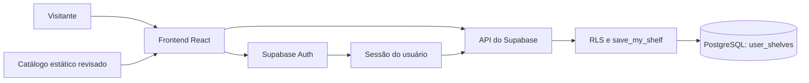

# Arquitetura do GitHub Bookshelf

Estrutura vigente em 17/10/2026. Este documento define responsabilidades; o histórico de tarefas fica no [registro de execução e revisão](REGISTRO-DE-EXECUCAO.md).

## Organização do produto

```text
GitHub Bookshelf/
├── frontend/                    Aplicação executada no navegador
│   ├── src/                     Componentes, páginas, contexto e hooks
│   │   ├── api/                 Cliente público do Supabase
│   │   └── services/            Operações da estante pela API
│   ├── public/                  Recursos públicos do portal
│   ├── scripts/standalone.mjs    Empacotamento específico do frontend
│   ├── package.json             Comandos e dependências da aplicação
│   ├── vite.config.ts           Build, alias e localização do ambiente
│   └── dist/                    Aplicação hospedável gerada, ignorada
├── backend/
│   └── supabase/                Backend gerenciado do produto
│       ├── migrations/          Schema, função de gravação e políticas RLS
│       ├── tests/               Testes transacionais de isolamento
│       ├── CONFIGURACAO.md      Configuração, orientação e evidências
│       └── .env.local           Configuração local ignorada pelo Git
├── integrations/
│   ├── github/                  Repositório e autoria
│   ├── outlook/                 Contato do produto
│   ├── vercel/                  Hospedagem e domínio
│   └── locaweb/                 Zona DNS do subdomínio
├── security/                    Engenharia, testes, carga e modelos de segurança
├── docs/                        Arquitetura, curadoria e validação
│   └── REGISTRO-DE-EXECUCAO.md   Registro obrigatório de cada tarefa
├── tools/
│   ├── catalog/                 Curadoria e coleta de metadados
│   ├── tests/                   Integridade do catálogo
│   └── research/                Cache local ignorado
├── artifacts/                   HTML independente gerado, ignorado
├── .github/                     CI e publicação do frontend
├── AGENTS.md                    Regras obrigatórias de trabalho
├── README.md                    Entrada do repositório
├── CONTRIBUTING.md              Orientações de contribuição
├── THIRD_PARTY_NOTICES.md        Atribuições e licenças de terceiros
└── LICENSE                      Licença do repositório
```

`node_modules`, builds, cache e arquivos reais de conexão não são versionados. O `node_modules` da aplicação permanece em `frontend/`, junto do seu manifesto. A raiz não concentra código executável do produto.

## Responsabilidades e dependências

| Área                    | Executa onde                            | Responsabilidade                                            | Limite                                                    |
| ----------------------- | --------------------------------------- | ----------------------------------------------------------- | --------------------------------------------------------- |
| Frontend                | Navegador                               | Descoberta, busca, filtros, interação e estado da interface | Não tem chave administrativa ou acesso direto ao Postgres |
| Backend Supabase        | Serviço Supabase                        | Autenticação, dados de contas, validação e autorização      | A sessão define o proprietário da estante                 |
| Integrações             | Plataforma ou ferramenta correspondente | Repositório, contato e hospedagem                           | Credenciais locais separadas e ignoradas                  |
| Ferramentas de catálogo | Ambiente de manutenção                  | Seleção, fontes e atualização dos metadados                 | Não executam durante a visita ao portal                   |
| Artefatos               | Saída de build                          | Pacote hospedável e arquivo independente                    | Não editar nem tratar como fonte                          |

O cliente Supabase em `frontend/src/api/` faz parte do frontend: roda no navegador e utiliza a chave publicável. O backend possui código real em SQL, migrações e políticas em `backend/supabase/`. Não há servidor Node/Express próprio para iniciar.

## Fluxo de dados



Busca, filtros e catálogo funcionam localmente no navegador. Autenticação e estantes por conta usam o backend. Uma visita ao catálogo não dispara 150 consultas ao GitHub.

A estante de visitante fica separada das contas. Para uma conta, o cache local é identificado pelo usuário e a sincronização grava por revisão. Uma revisão desatualizada produz conflito em vez de sobrescrever silenciosamente outro dispositivo.

## Segurança e evolução do banco

- A chave publicável é distribuída com o aplicativo; a autorização é feita pela sessão e pelas regras do banco.
- Secret/service_role e senha do banco não podem entrar em variáveis `VITE_`, arquivos públicos ou documentação.
- O proprietário da gravação vem de `auth.uid()`, não de um ID escolhido pelo cliente.
- A migração aplicada é imutável como histórico. Uma mudança nova exige outra migração.
- Testes SQL usam transação e rollback para não deixar registros temporários.
- Nenhum conteúdo privado de estante deve entrar no registro de execução.

## Build e publicação

Comandos da aplicação: `npm --prefix frontend test` e `npm --prefix frontend run build`. O build gera `frontend/dist/` e `artifacts/GitHub Bookshelf.html`.

O workflow permanece em `.github/workflows/`, com diretório de execução `frontend`, cache em `frontend/package-lock.json` e artefatos nos caminhos acima. Na Vercel, usar a raiz do repositório e o arquivo `vercel.json`: instalação e build apontam para `frontend`, e a saída é `frontend/dist`. Isso mantém os diretórios irmãos disponíveis para as ferramentas de build. A CI valida em `ci.yml`; a publicação na nova conta é feita pela integração da Vercel, sem exigir GitHub Pages.

O Vite resolve `backend/supabase/` a partir do arquivo de configuração, com `fileURLToPath`. Isso evita depender do diretório do terminal e trata espaços no caminho do projeto. Na hospedagem, os valores são configurados como variáveis de ambiente, sem enviar o arquivo local.

A publicação do frontend não aplica migrações no Supabase. O banco tem seu próprio ciclo de mudança e conferência. Nenhuma alteração foi feita no schema remoto nesta reorganização.

## Desempenho e critérios de entrega

O catálogo é um retrato estático, revisado e versionado. A API do GitHub é consultada pela ferramenta de manutenção. O build separa código da aplicação, catálogo, SDK Supabase e bibliotecas, permitindo cache separado na hospedagem.

O build confere um orçamento inicial de peso: até 500 KB sem compressão por módulo JavaScript e 350 KB gzip para a soma do JavaScript gerado. A checagem falha se houver excesso e grava `artifacts/build-report.json`. Esse total inclui todos os módulos gerados; não é uma medição do carregamento inicial. Alterar o orçamento exige registrar a razão e a revisão, em vez de apenas aumentar o limite para passar.

A revisão atual mede integridade, execução, tamanhos de build e fluxos observados. Há ensaio limitado de HTTP local registrado em `security/CAPACIDADE.md`, sem auditoria independente ou certificação de desempenho. Core Web Vitals em domínio de produção, comportamento sob concorrência e capacidade de tráfego ainda precisam de medição.

Cada mudança deve preservar os dados, passar pelos testes apropriados e registrar o que foi realmente conferido. Não declarar qualidade ou desempenho apenas pela organização das pastas.

## Estado e limites conhecidos

O login da conta do produto, a gravação de um projeto com nota e progresso, a persistência após recarregar e a remoção do registro temporário foram conferidos no Chrome. Há testes de isolamento no banco. Recuperação de senha, dois dispositivos e concorrência pela interface continuam pendentes.

Português, inglês e espanhol estão em elaboração, sem seletor completo ativo. O repositório público exclusivo foi criado em `gitbokshelf/github-bookshelf`. O código foi enviado e o portal está em `https://githubbokshelf.hubdetrabalho.com.br/`, com Supabase configurado para essa origem. O subdomínio próprio usa CNAME na Locaweb e produção na Vercel. SMTP de produção e validações adicionais de autenticação permanecem pendentes. O endereço antigo da conta pessoal foi preservado como publicação anterior.

[Regras obrigatórias](../AGENTS.md) · [Registro](REGISTRO-DE-EXECUCAO.md) · [Mapa geral](../README.md)

## Domínio do produto

Endereço principal: `https://githubbokshelf.hubdetrabalho.com.br/`. O domínio raiz e o DNS dos outros serviços continuam na Locaweb. O CNAME do subdomínio aponta para o destino indicado pela Vercel; o certificado HTTPS é gerenciado pela hospedagem. A configuração está em [Locaweb](../integrations/locaweb/README.md) e [Vercel](../integrations/vercel/README.md).

O endereço `https://github-bookshelf.vercel.app/` permanece como alias funcional, com canonical apontando para o domínio principal. Origens diferentes têm sessões e caches de navegador separados; contas usam a mesma estante no Supabase. Não migrar dados locais de visitante silenciosamente.

## Engenharia de segurança

A área `security/` concentra modelo de ameaças, revisão, operação, prompt injection/agentes/integrações, testes defensivos, ferramentas e ensaio k6. Os modelos em `security/templates/` podem iniciar outro projeto, com adaptação e nova validação. Os controles não são transferidos como certificação.

`vercel.json` aplica CSP, anti-framing, nosniff, referrer restrito e permissões do navegador. A inicialização de tema é um script próprio externo para permitir bloquear JavaScript inline. O preview reproduz os headers, exceto HSTS/upgrade HTTPS no HTTP local. CSS de atributos continua permitido para React/Motion; fontes Google são os únicos recursos externos de estilo/fonte. As conexões da aplicação são limitadas à origem e ao projeto Supabase específico.

O teste de build em `security/tools/check-build.mjs` rejeita scripts inline/externos, arquivos privados/sourcemaps e padrões administrativos examinados. Os testes em `security/tests/` verificam contrato de importação, tamanho, chaves hostis e configuração HTTP. O atualizador de catálogo valida slugs/URLs e não executa READMEs. As regras de agentes são obrigatórias, mas não representam sandbox técnico implementado.

CI e workflows de segurança têm timeout e Actions por SHA; Dependabot propõe atualizações. O GitHub tem proteção de push/secret scanning e relatos privados. Continuam pendentes: quota de gravação na API, CAPTCHA, recuperação/SMTP, restauração comprovada, observabilidade com alertas e ensaio de capacidade autenticada em staging. Ver `security/REVISAO.md`.
