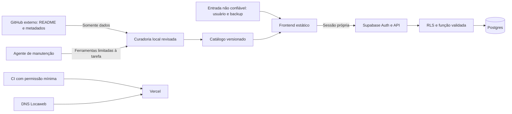

# Modelo de ameaças

Versão inicial: 17/10/2026. Escopo: frontend React/Vite na Vercel, Auth/Postgres Supabase, publicação GitHub, DNS Locaweb e ambiente de manutenção local. O produto não possui execução de LLM ou agente em produção.

## Ativos e fronteiras

Ativos: estantes privadas, identidade/sessões, código e histórico, credenciais administrativas, domínio, disponibilidade e custos. Catálogo e chave publicável são públicos.

## Cenários e controles

| Cenário | Controle presente | Limite ou ação pendente |
| --- | --- | --- |
| Ler ou escrever estante de outra conta | RLS de leitura própria, escrita direta revogada, RPC deriva `auth.uid()`, sessão capturada por requisição | Repetir isolamento em CI com Supabase descartável e duas contas reais de teste |
| Sobrescrever edição de outro dispositivo | Revisão otimista e conflito explícito, backup local antes de recarregar remoto | Testar concorrência real e recuperação offline em aparelhos distintos |
| XSS por nota, catálogo ou backup | React escapa texto; importação estrita/atômica; CSP sem script inline/eval/terceiro; campos extras descartados | Sessão em localStorage mantém risco se uma futura falha de XSS for introduzida; CSP não substitui revisão |
| Backup excessivo ou malformado | Limite de arquivo e conteúdo de 2 MiB, notas até 10 mil caracteres, schema e tamanho após mescla | Limite SQL usa representação JSONB, com espaços: cargas no limite podem ser recusadas pelo servidor; o cliente preserva cache e informa falha |
| SQL injection ou ID arbitrário | SDK/RPC com parâmetros, SQL estático, search_path vazio; nenhum SQL vindo de backup | Nova SQL dinâmica exige revisão própria |
| Clickjacking e carregamento de código remoto | frame-ancestors none, X-Frame-Options DENY; scripts e conexões restritos | CSS inline de atributos é permitido para estilos React/Motion; não autoriza JavaScript inline |
| Vazamento no Git/build | Gitignore, Gitleaks, proteção de push/secret scanning, inspeção de distribuição | Credenciais locais estão em pasta sincronizada OneDrive: ignorar no Git não criptografa nem revoga acesso à nuvem |
| Dependência ou workflow comprometido | Lockfile, npm ci/audit, Actions fixadas por SHA, CodeQL, Dependabot | Atualizações e alertas precisam de revisão humana; não há garantia de ausência de vulnerabilidades inéditas |
| Força bruta, bots e abuso de escrita | Auth tem controles próprios; dados isolados; frontend servido estaticamente | CAPTCHA e quotas específicas de gravação ainda não implementados. Limites de Auth não cobrem RPC de estante |
| DDoS, custos e indisponibilidade | Catálogo estático, CDN; orçamento do bundle; mitigação do provedor | Capacidade do banco, regras personalizadas de firewall, alertas e plano de continuidade ainda precisam de ensaio/configuração |
| Prompt injection indireta | Conteúdo externo é dado, não instrução; nenhuma execução de README pelo atualizador; regras de agentes e teste de fronteiras | As regras de agentes são processuais. Não equivalem a isolamento técnico de uma futura integração LLM |
| Sequestro do domínio/admin | HTTPS e separação de serviços; DNS preservado | Conferir MFA, recuperação, papéis e sessões administrativas em cada provedor com o proprietário |

## Riscos prioritários abertos

Antes de divulgar cadastros amplamente: SMTP/ciclo de recuperação, proteção contra automação no Auth, quota de gravação no servidor e monitoramento de erros/consumo. Rate limiting deve operar na API/RPC ou gateway obrigatório para o endpoint, sem permitir contorno por acesso direto ao Supabase. Debounce no navegador e firewall da Vercel não protegem a API externa do Supabase.

Antes de prometer escala ou recuperação: ambiente separado de ensaio, teste de isolamento automatizado, carga autenticada gradual, backup criptografado e restauração comprovada. Definir SLO/RPO/RTO com evidência e custos aceitos; não apresentar objetivos como desempenho já atingido.
